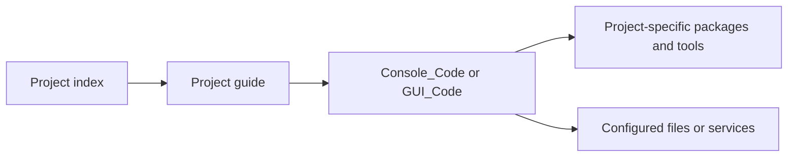

# Python projects and examples

Independent Python scripts and small applications for automation, networking, desktop interfaces, image and audio processing, and machine learning.

[](https://github.com/gcfernando/python-projects-and-examples/actions/workflows/repository-standards.yml) [](https://gcfernando.github.io/python-projects-and-examples/)

<a id="-python-projects-and-code-examples"></a>

<a id="-python-projects-and-code-examples--automation-networking-desktop-gui-media-and-machine-learning"></a>

<a id="python-projects--automation-media-and-machine-learning"></a>

<a id="-overview"></a>

<a id="guide-features"></a>

<a id="-features"></a>

## Start here

For a first run, try the standard-library [Custom Exception](Custom%20Exception/readme.md) or [Object Clone](Object%20Clone/readme.md) example. To find a specific task, use the grouped index below or the [guide index](documentation.md).

Each project has its own dependencies and platform requirements. Read its guide before executing it: some scripts change files or Windows settings, contact external services, or contain documented defects.

## What you can explore

Standard-library and async examples; Rich command-line tools; Tkinter interfaces; Flask and Streamlit dashboards; image, audio and text-to-speech utilities; regression and time-series exercises.

<a id="usage"></a>

<a id="-project-index"></a>

<a id="guide-usage"></a>

<a id="-usage"></a>

## Example index

Open the project guide for its exact command, working directory, dependencies, and limitations.

<a id="-web-networking--automation"></a>

### Web, networking & automation

| Project | What it does |
|---|---|
| [Async HTTP](Async%20HTTP/readme.md) | Interactive asynchronous GET, POST, PUT, and DELETE requests to a sample REST API. |
| [Bookmark](Bookmark/readme.md) | Save, search, edit, delete, and open links stored in a local SQLite database. |
| [FixNetwork](FixNetwork/readme.md) | Windows network diagnostics and repair steps, including network-stack and adapter resets. |
| [Internet Speed Test](Internet%20Speed%20Test/readme.md) | Measure download, upload, and ping using Speedtest.net servers. |
| [Port Scanner](Port%20Scanner/readme.md) | Concurrent TCP connect scans with IPv4/IPv6, optional banners, and open-port JSON output. |
| [Simple Selenium Scraper](Simple%20Selenium%20Scraper/readme.md) | Use headless Chrome and Selenium to collect cricket-news headlines. |
| [Streamlit Demo](Streamlit/readme.md) | Explore Streamlit widgets, interactive data, and charts in a browser app. |
| [WiFi Radar setup](https://gcfernando.github.io/python-projects-and-examples/Wifi%20Radar/guide.html) · [Static dashboard preview](https://gcfernando.github.io/python-projects-and-examples/Wifi%20Radar/index.html) | Local Flask dashboard for nearby access points, with live scanning and CSV export. |
| [WiFi Scanner](Wifi%20Scanner/readme.md) | Scan nearby wireless networks and display signal, frequency, and security details. |
| [WiFi Profiles](Wifi%20Profiles/readme.md) | Manage saved Windows Wi-Fi profiles and inspect their stored connection details. |

<a id="-media-images--creative-tools"></a>

### Media, images & creative tools

| Project | What it does |
|---|---|
| [Graphite CLI](Graphite_CLI/README.md) | Convert a photo into a black-and-white graphite pencil sketch with a single OpenCV command. |
| [Image to ASCII](Image%20to%20ASCII/readme.md) | Convert an image into ASCII art saved as a text file. |
| [Image2Cartoon](Image2Cartoon/readme.md) | Apply OpenCV filters to create a cartoon-style image. |
| [Improve MP3 Quality](Improve%20MP3%20Quality/readme.md) | Re-encode MP3 files with configurable bitrate, channels, and sample rate. |
| [Lyrics](Lyrics/readme.md) | Search Genius for song metadata and a lyrics preview. |
| [MP3 Player](MP3%20Player/readme.md) | Shuffle a folder of MP3s with background preloading and crossfade transitions. |
| [MP3 Tags](MP3%20Tags/readme.md) | Read ID3 metadata and technical audio details from an MP3 file. |
| [QR Code](QR%20Code/readme.md) | Generate a styled QR code image from text or a URL. |
| [Remove Background](Remove%20Background/readme.md) | Remove an image background and composite the subject onto a solid backdrop. |
| [Steganography](Stenography/readme.md) | Hide and retrieve text in PNG images using least-significant-bit encoding. |
| [Story Reader](StoryReader/readme.md) | Extract text from a PDF and read it aloud with text-to-speech. |
| [Tag Clouds](TagClouds/readme.md) | Collect web-page text and render a word cloud using an image mask. |
| [Text2Audio](Text2Audio/readme.md) | Desktop text-to-speech app with selectable language and locale options. |

<a id="-desktop-apps--system-utilities"></a>

### Desktop apps & system utilities

| Project | What it does |
|---|---|
| [Contact Book](GUI_Apps/README.md) | Desktop contact manager backed by Microsoft SQL Server. |
| [Extract CPU Information](Extract%20CPU%20Information/readme.md) | Display CPU model, architecture, frequency, and core information. |
| [Health Monitor](Health%20Monitor/readme.md) | Live process-memory dashboard with heuristic growth warnings. |
| [Load Libraries](LoadLibraries/readme.md) | Call a compiled C#/.NET calculator library from Python using `pythonnet`. |
| [Password Utility](Password%20Utility/readme.md) | Explore password generation and a character-count rating heuristic. |
| [Setup Wizard — Fruit Wiki](SetupWizard/readme.md) | Browse fruit images and descriptions in a paginated desktop GUI. |
| [Simple WhatsApp Sender](Simple%20WhatApp%20Sender/readme.md) | Schedule a WhatsApp message through WhatsApp Web. |
| [Use Twilio](Use%20Twilio/readme.md) | Send SMS or WhatsApp messages and place calls through Twilio. |
| [Use Windows Login](Use%20Windows%20Login/readme.md) | Demonstrate checking the current Windows account credentials. |

<a id="-machine-learning--data"></a>

### Machine learning & data

| Project | What it does |
|---|---|
| [COVID Forecast](ML/COVID%20Forecast/readme.md) | Analyze and forecast daily COVID-19 case data with ARIMA/SARIMAX models. |
| [Salary Prediction](ML/Salary/readme.md) | Train a linear-regression salary model and use it for interactive predictions. |

<a id="-python-fundamentals--persistence"></a>

### Python fundamentals & persistence

| Project | What it does |
|---|---|
| [Custom Exception](Custom%20Exception/readme.md) | Define, raise, and catch a custom Python exception. |
| [Database](Database/README.md) | Store and retrieve key-value data using Python's built-in `dbm` module. |
| [Object Clone](Object%20Clone/readme.md) | Demonstrate independent object copies with `copy.deepcopy()`. |

<a id="-getting-started"></a>

<a id="guide-quick-start"></a>

<a id="-quick-start"></a>

## Quick start

Try a standard-library example first. From your terminal:

```bash
git clone https://github.com/gcfernando/python-projects-and-examples.git
cd python-projects-and-examples
python "Custom Exception/Console_Code/CustomException.py"
```

Expected output: `Something went wrong`. For an independent copy example:

```bash
python "Object Clone/Console_Code/CloneObject.py"
```

Expected output is `20` followed by `10` on separate lines. These examples need no packages, accounts, network requests, or local asset changes.

<a id="-prerequisites-and-installation"></a>

## Prerequisites and installation

Install Python 3 and Git to clone the collection. Check the selected guide for its Python version, third-party packages, platform tools, and required services. Port Scanner and Graphite CLI document Python 3.10+; that is not a tested minimum for every other project.

For examples with packages, create an isolated environment from the repository root:

```bash
python -m venv .venv
```

Use its interpreter directly, without changing shell execution policy:

```powershell
# Windows PowerShell: install Bookmark's dependency
.\.venv\Scripts\python.exe -m pip install rich
.\.venv\Scripts\python.exe "Bookmark/Console_Code/book_marks.py"
```

```bash
# macOS / Linux: the equivalent commands
.venv/bin/python -m pip install rich
.venv/bin/python "Bookmark/Console_Code/book_marks.py"
```

Bookmark creates `links.db` in the current working directory. Other scripts resolve assets from their own documented working directory. There is no repository-wide `requirements.txt`; install only the packages needed by your selected example.

<a id="-configuration"></a>

## Configuration

Many scripts contain editable settings rather than CLI options. Check each guide for input/output paths, service endpoints, model files, credentials, and database setup. Environment-variable snippets in a guide are proposed adaptations unless its source already reads them.

Use your own credentials and keep them outside commits and copied terminal output. The SQL Server and API examples require particular care when replacing their embedded settings.

<a id="a-colorful-collection-of-python-experiments-utilities-and-applications"></a>

## Open in your browser

| HTML source | View page | Setup guide |
|---|---|---|
| [Wifi Radar/index.html](https://github.com/gcfernando/python-projects-and-examples/blob/main/Wifi%20Radar/index.html) | [Open WiFi Radar — static dashboard preview](https://gcfernando.github.io/python-projects-and-examples/Wifi%20Radar/index.html) | [Run the local Flask scanner](https://gcfernando.github.io/python-projects-and-examples/Wifi%20Radar/guide.html) |

The filename opens the HTML source on GitHub. The hosted preview can display and export simulated data. Live scanning and export of real scan results require the local Flask server; GitHub Pages does not run the scanner.

<a id="architecture"></a>

<a id="-repository-layout"></a>

<a id="️-repository-layout"></a>

<a id="-architecture"></a>

## Repository layout

The projects are independent scripts rather than modules in a single application:



`ML/` groups training and forecasting projects; `GUI_Apps/` contains Contact Book. [The documentation index](documentation.md) provides guide navigation and links to the existing Pages site. No application source layout has to change to use the guides.

<a id="-development-and-testing"></a>

## Development and testing

There is no repository-wide application test suite; the Repository standards workflow checks metadata separately. Start with the two standard-library commands above, then verify one example at a time with disposable inputs and the setup in its guide. Do not import arbitrary scripts as a test: many execute prompts, GUI code, network operations, or file changes at module scope.

The [archived Audio8D workflow](.github/legacy-workflows/README.md) documents a former application directory and cannot run from its archive location. Current packaging belongs to the separate [Audio8D repository](https://github.com/gcfernando/8d-audio-converter).

For documentation and metadata changes, run `python .github/scripts/check_repository.py` with Python 3.12 or later. See [Contributing](CONTRIBUTING.md) for the scope of that check.

<a id="-before-you-run-a-project"></a>
<a id="-faq"></a>

<a id="️-before-you-run-a-project"></a>

<a id="guide-troubleshooting-and-limitations"></a>

<a id="-troubleshooting-and-limitations"></a>

## Troubleshooting and limitations

| Symptom or task | Check first |
|---|---|
| `ModuleNotFoundError` | Install the selected guide's packages with the same interpreter used to run it. |
| Missing file or DLL | Replace hardcoded paths; use the working directory in the guide. |
| GUI, audio, or platform failure | Check desktop/audio availability and Windows-only dependencies; many examples have not been tested across all platforms. |
| HTTP or browser automation failure | External services, selectors, drivers, and unpinned library APIs can change. The Selenium guide documents required source adaptations. |
| Incorrect numerical or status output | Read the CPU temperature, speed-test units, Wi-Fi labels, MP3 bitrate, and memory-growth caveats in their guides. |

`FixNetwork` changes Windows networking settings. `Wifi Profiles` displays saved credentials and deletes profiles by default. The MP3 re-encoder replaces originals. Review those guides before execution and use appropriate test data. Messaging and API examples contact external services; use intended recipients and your own service configuration.

The [Database example](Database/README.md) documents an existing byte-key bug. The machine-learning examples are teaching exercises, with evaluation and dependency limits explained in their guides.

<a id="-contributing"></a>

## Contributing

Submit a focused issue or pull request in [this repository](https://github.com/gcfernando/python-projects-and-examples). Include the project path, operating system, Python/package versions, steps to reproduce, and redacted error output. When changing a script, update its guide with the exact command and working directory you verified.

<a id="-security"></a>

## Security

Avoid posting passwords, tokens, connection strings, saved Wi-Fi data, or private model/input files in public issues. Use the [security policy](SECURITY.md) and GitHub private vulnerability reporting for sensitive findings.

<a id="-support-and-license"></a>

## Support and license

Use repository issues for setup questions, with the project name and reproducible details. No repository-level license file is tracked; do not infer reuse terms for the code, bundled binaries, fonts, images, or datasets. Third-party components have their own terms.

<a id="-related-projects"></a>

## Related projects

- [Audio8D](https://github.com/gcfernando/8d-audio-converter) — a separate FFmpeg-based desktop and CLI audio converter.
- [Machine-learning datasets](https://github.com/gcfernando/machine-learning-practice-datasets) — CSV practice datasets.
- [Developer guides and tools](https://github.com/gcfernando/developer-guides-and-tools) — Python OOP and dunder-method references.
- [C# and .NET examples](https://github.com/gcfernando/csharp-dotnet-examples) — includes the reverse Python.NET bridge.

## Documentation links

[Guide index](documentation.md) · [All developer projects](https://gcfernando.github.io/gcfernando/projects/)

## Repository maintenance

[Contributing](https://github.com/gcfernando/python-projects-and-examples/blob/main/CONTRIBUTING.md) · [Security policy](https://github.com/gcfernando/python-projects-and-examples/blob/main/SECURITY.md) · [Repository standards](https://github.com/gcfernando/python-projects-and-examples/blob/main/REPOSITORY_STANDARDS.md)
